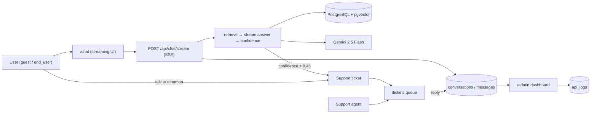

# SageBase

A RAG (retrieval-augmented generation) knowledge base starter. Upload documents
(PDF, `.txt`, `.md`), ask questions in plain English, and get answers with
inline citations to the retrieved chunks — plus a mini evals dashboard that
scores answer quality with transparent heuristics.

Built to showcase modern AI full-stack skills: **Next.js 14 + TypeScript +
PostgreSQL + pgvector + OpenAI embeddings & chat**.

## How it works

```
 ┌────────┐   ┌─────────┐   ┌─────────┐   ┌──────────┐
 │ Upload │──▶│ Extract │──▶│ Chunk   │──▶│ Embed    │
 │ PDF /  │   │ text    │   │ ~800 ch │   │ text-    │
 │ txt/md │   │         │   │ 100 ov. │   │ embedding│
 └────────┘   └─────────┘   └─────────┘   │ -3-small │
                                          └────┬─────┘
                                               ▼
 ┌────────┐   ┌──────────┐   ┌──────────┐  ┌──────────┐
 │ Answer │◀──│  Prompt  │◀──│ Retrieve │◀─│ pgvector │
 │ + [1]  │   │ cited    │   │ top-5 by │  │ document │
 │ [2]    │   │ context  │   │ cosine   │  │ _chunks  │
 └────────┘   └──────────┘   └──────────┘  └──────────┘
```

1. **Upload** — drop a PDF, `.txt`, or `.md` file in the Library.
2. **Chunk & embed** — text is split into ~800-character chunks (100-char
   overlap) and embedded with `text-embedding-004` (768 dims, Gemini free tier).
3. **Store** — chunks + vectors land in Postgres via the pgvector extension.
4. **Retrieve** — each question is embedded and matched with cosine similarity
   (`<=>`) against stored chunks; the top 5 become cited sources.
5. **Answer** — an LLM answers using only the retrieved context, with `[1]`,
   `[2]` markers you can click to inspect the exact source chunk.
6. **Evaluate** — the Evals dashboard runs 5 canned Q&A pairs through the same
   pipeline and scores citation coverage + keyword recall (heuristic, demo).

## V2 — AI Customer Support Agent

V2 evolves the RAG knowledge base into a production-style support agent:
streaming chat with per-answer confidence, persistent conversation history,
thumbs up/down feedback, follow-up suggestions, low-confidence escalation into
a human support queue, and an admin analytics dashboard.



### Features

| Area | What it does |
|---|---|
| Auth | Credentials login with roles (`ADMIN`, `SUPPORT_AGENT`, `END_USER`); HMAC-signed HTTP-only session cookies; seeded demo logins work with zero config |
| Conversations | Sidebar with persistent history (DB in live mode, in-memory in demo); guests get a stable anonymous identity |
| Streaming | Answers stream token-by-token over SSE (`ReadableStream`); demo mode streams mock answers the same way |
| Confidence | Per-answer score (mean of top-3 retrieval scores) with a UI badge; low-confidence answers auto-file a support ticket |
| Follow-ups | 3 suggested questions per answer (LLM-generated live, deterministic picks in demo), rendered as chips |
| Feedback | Thumbs up/down per answer, persisted; feeds the analytics dashboard |
| Escalation | "Talk to a human" button + auto-escalation → ticket queue (`OPEN` → `IN_PROGRESS` → `RESOLVED`); agent replies are mirrored into the chat |
| Analytics | Admin dashboard: 14-day query volume, escalation rate, avg confidence, p95 latency, feedback ratio (hand-rolled SVG charts) |
| Ops | Per-caller rate limiting (429 + `Retry-After`) and an `api_logs` table behind every route via one `withApi` wrapper |

Demo logins (work with zero config): `admin@sagebase.demo` / `admin123`,
`agent@sagebase.demo` / `agent123`, `user@sagebase.demo` / `user123`.
In live mode these accounts are auto-created on first login (set
`DISABLE_DEMO_USERS=1` to turn that off).

### Tradeoffs (why these choices)

- **pgvector over Pinecone/Weaviate.** The corpus is small, the team is one
  person, and the budget is zero. pgvector keeps vectors next to relational
  data (tickets, messages) in the single Neon Postgres we already run — no
  second service, no sync jobs, no bill. If the corpus passed ~100k chunks,
  an `ivfflat`/`hnsw` ANN index (commented in the migration) comes before any
  managed vector DB.
- **Gemini free tier over OpenAI.** Same zero-spend logic: `text-embedding-004`
  (768 dims) + `gemini-2.5-flash` via the OpenAI-compatible endpoint, so the
  `openai` client works unchanged. The provider is one base URL + one model
  constant away from being swapped.
- **Streaming via raw `ReadableStream`/SSE, not a helper lib.** The protocol
  is ~15 lines (`token` / `done` / `error` events) and the client parses it
  with a 20-line reader loop. No dependency, full control over the `done`
  trailer that carries sources, confidence, and follow-ups.
- **Hand-rolled HMAC sessions instead of Auth.js.** One credentials provider
  for three demo roles doesn't justify the dependency; scrypt + signed
  cookies is ~80 lines with zero new packages. A real deployment with OAuth
  providers should switch to Auth.js/Clerk — noted as the production path.
- **In-memory rate limiting instead of Redis.** Fine for a demo and honest
  about its limits: counters are per-instance, so it's approximate on
  serverless. Upstash Redis is the documented upgrade.
- **Confidence as mean top-3 retrieval score.** Deliberately simple and
  explainable rather than calibrated — it's a triage signal for escalation,
  not a probability. Good enough to route "uncertain" answers to humans.
- **Demo mode mirrors every v2 table in memory.** The whole support workflow
  (auth, tickets, analytics) is explorable with zero env vars; the analytics
  dashboard seeds clearly-labeled sample data until real traffic exists.

## Demo mode

Without `DATABASE_URL` or `GEMINI_API_KEY` the app runs fully in **demo
mode**: two realistic seed documents live in memory, uploads are kept
ephemerally in memory, retrieval uses keyword-overlap ranking, and answers are
clearly-labeled mock responses. A banner at the top of every page says so.

## Getting started

```bash
npm install

# 1. Copy env and fill in values
cp .env.example .env

# 2. Create the database objects (needs pgvector on the server)
npx prisma migrate deploy

# 3. Run it
npm run dev
```

Open http://localhost:3000. Upload a document in **Library**, then ask about it
in **Chat**. Try the **Evals** page to see the pipeline scored end to end.

Useful scripts:

| Command            | What it does                    |
| ------------------ | ------------------------------- |
| `npm run dev`      | Start the dev server            |
| `npm run build`    | `prisma generate` + production build |
| `npm run typecheck`| `tsc --noEmit`                  |
| `npm run lint`     | `next lint`                     |

## API overview

| Method | Route                        | Description                                              |
| ------ | ---------------------------- | -------------------------------------------------------- |
| POST   | `/api/documents/upload`      | Multipart file upload → extract → chunk → embed → store  |
| GET    | `/api/documents`             | List documents with status + chunk counts                |
| DELETE | `/api/documents/[id]`        | Delete a document (chunks cascade)                       |
| POST   | `/api/chat`                  | `{ question }` → `{ answer, sources[] }`                 |
| GET    | `/api/evals`                 | Canned eval cases + last run results                     |
| POST   | `/api/evals/run`             | Run all eval cases through the pipeline and score them   |

Chat response shape:

```json
{
  "answer": "SageBase chunks text into ~800-character pieces [1]...",
  "sources": [
    {
      "index": 1,
      "documentId": "cm3...",
      "documentName": "handbook.md",
      "chunkIndex": 2,
      "content": "…chunk text…",
      "score": 0.87
    }
  ],
  "demo": false
}
```

## pgvector + Prisma caveats

- Prisma has no `vector` column type, so `document_chunks` is created by the
  SQL migration and accessed only via `$queryRaw` / `$executeRaw`
  (see `src/lib/rag.ts`). The `Document` model itself is a normal Prisma model.
- The migration runs `CREATE EXTENSION IF NOT EXISTS vector` — your Postgres
  user needs permission for that, or enable pgvector in your host's dashboard
  (most managed Postgres providers ship it).
- Retrieval uses an exact cosine scan (`ORDER BY embedding <=> $1 LIMIT 5`).
  Past ~100k chunks, add an ANN index (`ivfflat` / `hnsw`) — see the comment
  in the migration file.
- Embeddings are stored at 768 dims to match `text-embedding-004`. If you
  switch models, recreate the column with the new dimension (see the
  `gemini_768` migration for the pattern).

## Project structure

```
prisma/
  schema.prisma            # Document model (chunks live in raw SQL)
  migrations/…             # pgvector extension + document_chunks table
src/
  app/
    page.tsx               # Home: hero + how-it-works
    library/page.tsx       # Upload dropzone + document list
    chat/page.tsx          # Streaming support chat + conversation sidebar
    tickets/page.tsx       # Support-agent ticket queue
    admin/page.tsx         # Analytics dashboard (admin only)
    login/page.tsx         # Credentials login + demo accounts
    evals/page.tsx         # Evals dashboard
    api/
      chat/stream/route.ts # SSE streaming chat (tokens + done trailer)
      chat/route.ts        # Non-streaming chat (kept for compat)
      conversations/…      # Conversation + message CRUD
      tickets/…            # Ticket queue, status, agent replies
      feedback/route.ts    # Thumbs up/down
      analytics/route.ts   # Admin metrics (admin only)
      auth/…               # login / logout / me
  lib/
    chunk.ts               # 800-char / 100-overlap chunking
    pdf.ts                 # PDF text extraction
    embeddings.ts          # text-embedding-004 wrapper (Gemini native API)
    llm.ts                 # cited answers + streaming + follow-up suggestions
    rag.ts                 # pgvector retrieval, confidence, streaming pipeline
    demo.ts                # in-memory demo docs + mock answers
    demoStore.ts           # in-memory v2 tables (conversations, tickets, …)
    conversations.ts       # conversation/message data access (DB or demo)
    tickets.ts             # ticket data access (DB or demo)
    analytics.ts           # dashboard metrics (DB or demo sample data)
    auth.ts                # scrypt passwords, HMAC sessions, demo accounts
    api.ts                 # withApi: session + rate limit + request logging
    ratelimit.ts           # in-memory sliding-window limiter
    evals.ts               # canned cases + heuristic scoring
    db.ts                  # lazy Prisma client + env flags
  components/
    Navbar.tsx             # links + role badge + login/logout
```

## Roadmap

- Per-document and per-collection scoping for retrieval
- Hybrid retrieval (BM25 + vector) and reranking
- Real eval harness (LLM-as-judge) replacing the heuristic scorer
- OAuth providers via Auth.js (replacing the hand-rolled session)
- Shared rate limiting via Upstash Redis for serverless

## Screenshots

_Add screenshots here once deployed:_

- `docs/screenshots/home.png` — landing page
- `docs/screenshots/library.png` — document library with status badges
- `docs/screenshots/chat.png` — chat with citations + source panel
- `docs/screenshots/evals.png` — evals dashboard
